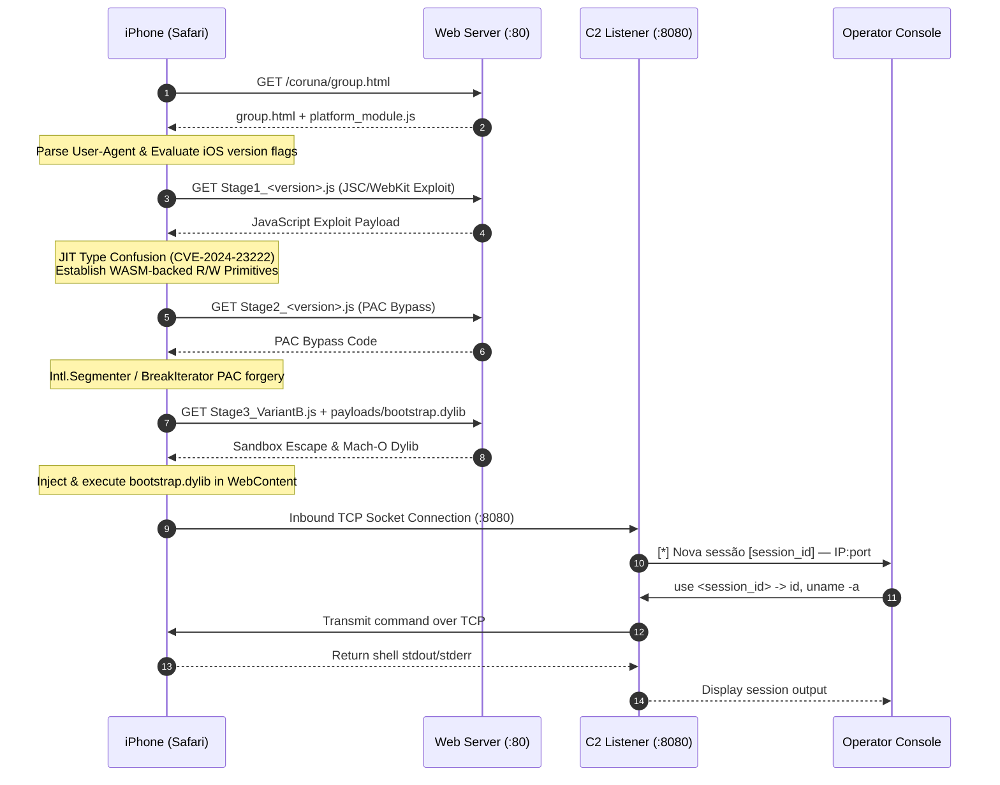

# System Architecture — Coruna iOS Orchestrator

This document provides a comprehensive technical breakdown of the **Coruna iOS Orchestrator** (CVE-2024-23222) exploit delivery framework, memory primitives, PAC bypass mechanisms, payload delivery pipeline, and C2 communication subsystem.

---

## 1. High-Level System Architecture

The orchestrator operates as a unified asynchronous service running two concurrent listeners:
1. **HTTP Web Server**: Delivers the multi-stage browser exploit chain tailored dynamically to the connecting iOS device.
2. **C2 TCP Listener**: Receives inbound reverse connections from compromised WebContent processes and bridges them to an operator terminal.



---

## 2. Exploit Delivery Pipeline

### 2.1 Loader (`exploits/coruna/group.html`)

`group.html` serves as the entry point and orchestrator on the victim device. Key functions include:
- **Environment Sanitation**: Detects whether the exploit has already executed during the current browser session using `sessionStorage.getItem("coruna_done")` to avoid repeated crash loops ("A problem repeatedly occurred").
- **Dynamic Module Manager**: Exposes `moduleManager` to dynamically fetch and evaluate modules based on device capabilities.
- **Primitive Normalization**: Unifies varying primitive method signatures across modules (e.g. normalizing `tr`, `Mr`, `br`, `dr` in Bluebird to standard `addrof`, `fakeobj`, `read32`, `write32`, `readByte`, `readDoubleAsPointer`).

### 2.2 Device Fingerprinting (`exploits/coruna/platform_module.js`)

Before triggering any memory corruption, `platform_module.js` analyzes:
- Safari `navigator.userAgent` and platform indicators.
- Major, minor, and patch numbers mapped to specific build strings.
- Sets granular capability flags:
  - `JtEUci`: iOS 16.6 – 17.2.1 (Cassowary)
  - `KeCRDQ`: iOS 16.2 – 16.5.1 (Terrorbird)
  - `ShQCsB`: iOS 15.6 – 16.1.2 (Bluebird)
  - `RbKS6p`: iOS 15.2 – 15.5 (Jacurutu)
  - `mmrZ0r`: iOS 13.0 – 15.1.1 (Buffout)
  - `wF8NpI` / `LJ1EuL` / `CpDW_T`: Seedbell PAC bypass selector
  - `wC3yaB`: Determines Stage 3 VariantA vs VariantB

---

## 3. Exploit Stages Breakdown

### 3.1 Stage 1 — WebKit / JSC Primitives (CVE-2024-23222)

The vulnerability resides in JavaScriptCore's JIT compiler optimization passes, causing a type confusion when optimizing certain property accesses and object shapes.

| Module | Target iOS Range | Vulnerability / Technique |
|---|---|---|
| **Cassowary** (`Stage1_16.6_17.2.1_cassowary.js`) | 16.6 – 17.2.1 | JIT type confusion via optimized loop; WASM memory primitive |
| **Terrorbird** (`Stage1_16.2_16.5.1_terrorbird.js`) | 16.2 – 16.5.1 | JSC type confusion creating overlapping TypedArrays |
| **Bluebird** (`Stage1_15.6_16.1.2_bluebird.js`) | 15.6 – 16.1.2 | Array prototype JIT confusion; normalized via aliases |
| **Jacurutu** (`Stage1_15.2_15.5_jacurutu.js`) | 15.2 – 15.5 | WASM ArrayBuffer backing store corruption |
| **Buffout** (`Stage1_13.0_15.1.1_buffout.js`) | 13.0 – 15.1.1 | Legacy WebKit structure ID manipulation |

#### Abstract Memory Primitive Interface
Regardless of the Stage 1 implementation loaded, the module normalizes into standard methods:
- `addrof(obj)`: Obtains memory address of arbitrary JavaScript object.
- `fakeobj(addr)`: Crafts a JavaScript object reference pointing to arbitrary memory.
- `read32(addr)` / `write32(addr, val)`: 32-bit arbitrary memory read/write.
- `readByte(addr)`: Reads a single byte (used during Mach-O export trie parsing).
- `readDoubleAsPointer(addr)`: Reads 64-bit pointers as floating-point values for comparison.
- `readString(addr, len)`: Reads null-terminated C-strings from process memory.

---

### 3.2 Stage 2 — Pointer Authentication Code (PAC) Bypass

Devices with Apple ARM64e processors (A12 Bionic and newer) protect function pointers and return addresses with cryptographic signatures (PAC). Stage 2 bypasses PAC to forge signed pointers:

- **Seedbell** (`Stage2_17.0_17.2.1_seedbell.js`, `Stage2_16.6_16.7.12_seedbell.js`, `Stage2_16.3_16.5.1_seedbell.js`):
  Uses type confusion inside `Intl.Segmenter` / `BreakIterator` internal C++ data structures to sign arbitrary pointers or redirect execution flow to PAC-signing gadgets.
- **Breezy / Breezy15** (`Stage2_13.0_14.x_breezy.js`, `Stage2_15.0_16.2_breezy15.js`):
  Employed on earlier iOS versions where PAC validation gadgets could be triggered via object vtables.

---

### 3.3 Stage 3 — Sandbox Escape & Mach-O Injection

Stage 3 (`Stage3_VariantA.js` and `Stage3_VariantB.js`) delivers native code execution:
1. **Mach-O Construction**: Parses the in-memory structure of WebContent and loads Mach-O binaries dynamically.
2. **Payload Resolution**: Reads `payloads/manifest.json` and fetches `payloads/bootstrap.dylib`.
3. **Dylib Loading**: Maps `bootstrap.dylib` into executable memory, resolves dependent symbols (e.g. `libsystem_kernel.dylib`, `libsystem_c.dylib`), and executes the dylib entrypoint.
4. **Implant Execution**: The injected dylib initiates an outbound TCP socket to the configured C2 server port (8080).

---

## 4. C2 Communication Subsystem

The C2 listener (`c2_comms/c2_server.py` & `c2_comms/session.py`) is built using Python's `asyncio`:

- **Session Multiplexing**: Each incoming socket connection is assigned an 8-character UUID (`session.id`), recording the target IP, port, and connection time.
- **Non-blocking I/O**: `asyncio.StreamReader` and `asyncio.StreamWriter` handle concurrent reverse connections without thread-per-client overhead.
- **Output Buffering**: Responses from the target implant are stored in `session.output_buffer` and flushed when the operator interacts with the session via `use <id>`.

```
               ┌───────────────────────────────────────────────┐
               │              C2Server (asyncio)               │
               │                                               │
               │   active_sessions: Dict[str, Session]         │
               │   ├── "a1b2c3d4" -> Session (192.168.1.10)   │
               │   └── "e5f6g7h8" -> Session (10.0.0.5)        │
               └───────────────▲───────────────────────────────┘
                               │
            ┌──────────────────┴──────────────────┐
            │                                     │
   Inbound TCP Socket                     Inbound TCP Socket
 (Target 1 WebContent)                  (Target 2 WebContent)
```

---

## 5. Web Exploit Server Subsystem

The HTTP delivery engine (`web_server/exploit_http_server.py`) uses `aiohttp`:

- **MIME Type Enforcement**: The `js_mime_middleware` inspects all outgoing requests for `.js` files and explicitly enforces `Content-Type: application/javascript; charset=utf-8`. iOS Safari strictly rejects scripts delivered with incorrect or generic MIME types (e.g. `text/plain`).
- **TLS ClientHello Suppression**: Mobile devices or scanning bots attempting HTTPS connections on port 80 produce TLS `ClientHello` frames, causing standard HTTP servers to raise noisy `BadStatusLine` exceptions. The custom `_BadStatusLineFilter` logging filter suppresses these errors to maintain clean console output.
- **Dynamic Routing**:
  - `/` and `/coruna` -> Redirects (302) to `/coruna/group.html`.
  - `/coruna/*` -> Serves exploit scripts and payloads from `exploits/coruna/`.
  - `/static/*` -> Serves optional static assets from `web_server/static/`.
